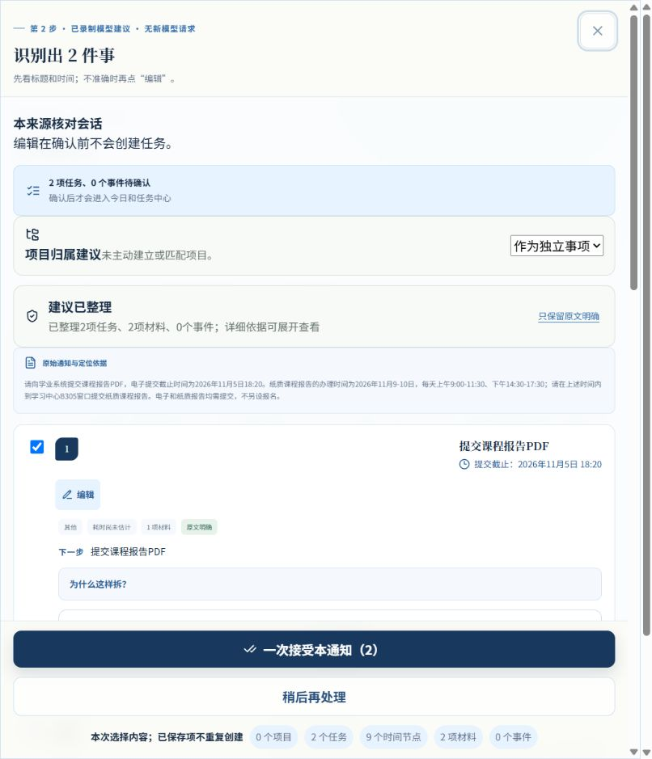
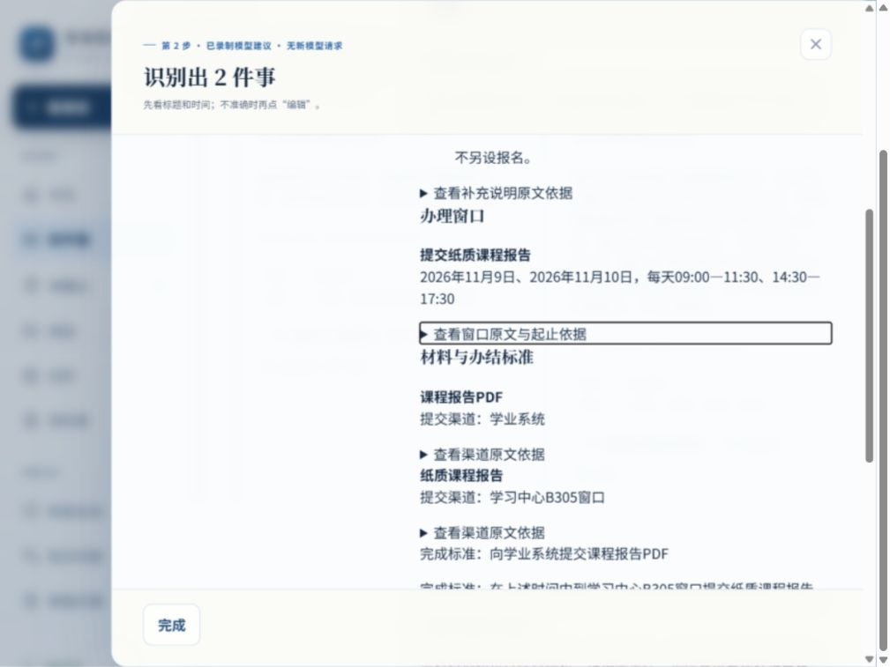
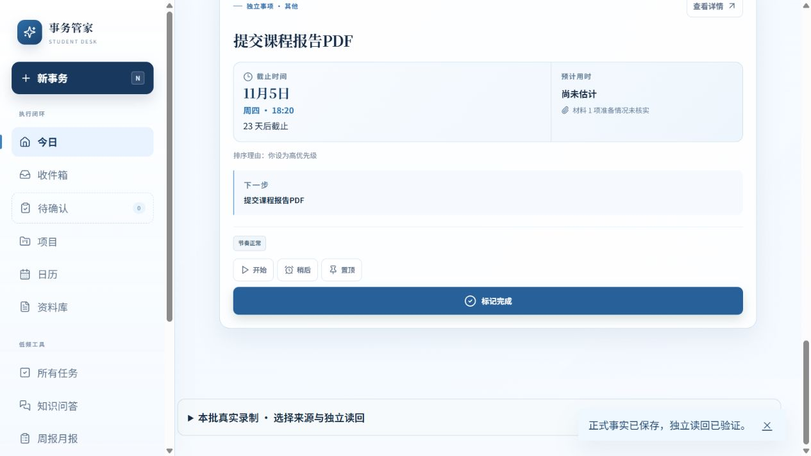
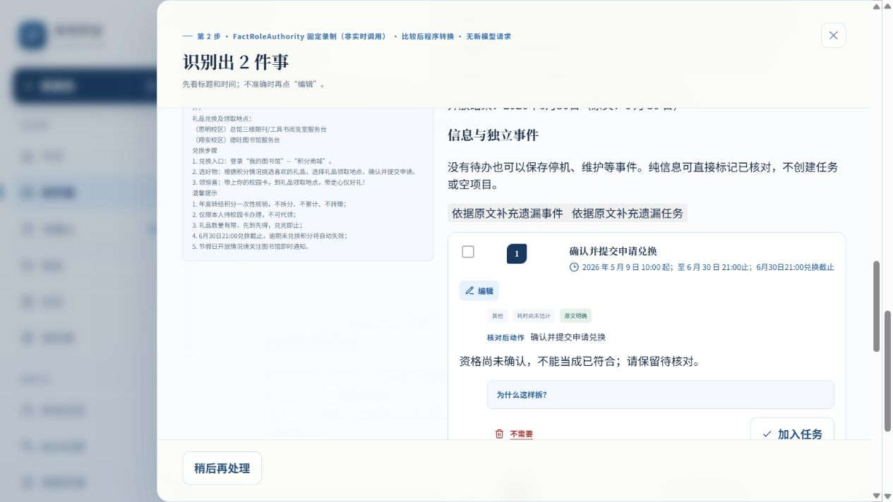

# 首次展示接续：共同义务、窗口摘要及真实例外

2026-10-13。工程提交 **9ce7bf91c7d446af57165c0553157f9da440f07c** 已立即普通推送。[本轮版本化证据](DISPLAY_RESULTS_20261013.json)，旧TIME_RESULTS及以下历史内容保持。本包实际开始13:04:48 UTC（北京时间21:04:48），180分钟截止16:04:48 UTC（次日00:04:48）；结束和最终文档SHA见交付回报。

## 用户实际少改了什么

TT01 FactRole原答“电子和纸质报告均需提交”不再因共同支持引用而整份消失，首次恢复2任务2材料3时间及双渠道。电子任务可零事实编辑单独接受；纸质办理窗口只有整段文字，两归一化值仍null，继续局部阻断，不能补成四个可信区间。

TaskTime同raw的8个TIME_SOURCE_SUPPORT_MISSING误提示消失；四窗口压成“2026年11月9日、2026年11月10日，每天09:00—11:30、14:30—17:30”。原八起止点/依据仍可展开；多材料、多时间和有事件本身中性，真实缺依据、冲突、资格和坏关系仍提示并局部阻断。首屏先行动与时间，后渠道/材料/办结。收件箱和弹层用持久Source/RecognitionRun元数据统一标固定录制/工程夹具；未知模式保持未知，不从modelName猜。

## 发生层与安全边界

| 根因 | 层 | 机制与反例 |
|---|---|---|
| 共有要求引用被全局拒绝 | SEMANTIC_COMPOSER支持索引 | authority-support-context-1.6.0 / declared-shared-requirement-support-1.0.0；仅同原文、已有动作/对象/必需状态且每个命名分支唯一绑定。不同对象表达通过；缺任务、假/异来源scope、新或错动作、optional和否定仍拒 |
| 连续来源范围误警告、数量与真实风险混合 | FIRST_ASSEMBLY / UI | first1.6.1检查真实相邻逐字覆盖；source-window-summary-1.0.0只汇总已验证canonical对。错日期/owner/引用/冲突/精度/全天回原文待核对；offset时间不截成错误本地时钟；first-review-exceptions-1.1.0只突出实际例外 |

原回答/转换审计/首次展示/用户选择沿App→ReviewSession→DomainCommitPlan→Repository保存。没有猜事实、实体、owner或日程；没有平行保存链、v8升级、默认替换、样本编号特判、Prompt/生成输入修改或旧评分放宽。原quality记录保留，“建议已整理”不等于语义正确。raw01匿名副本以真实SHA回归，原付费raw不动。

## 首答和首次页质量

single-author/model-assisted/provisional；标题、自由描述、独立真值及泄漏NOT_ADJUDICATED。

| 原六身份，各臂分母3：暂定完整/错或未闭合/未知 | FactRole | TaskTime |
|---|---|---|
| 原答（历史保持） | 0/0/3 | 1/0/2 |
| 原冻结首次（保持） | 0/1/2 | 0/1/2 |
| 本轮前公共首次 | 0/1/2 | 1/0/2 |
| 本轮后公共首次 | 0/1/2 | 1/0/2 |

TT01正确行动可显示，不代表FactRole纸质窗口已完整。TT02/TT03四NOT_SENT仍未知；**EVIDENCE_INCOMPLETE_NO_WINNER**。本轮减少确定程序损失与误警告，整份完整数尚未净增，没有新模型收益。旧4官方当前有效首次4/4、最小事实仍1暂定完整/1错/2未知；旧8首次事实逐份相同，原v11及所有历史成绩保持。

## 实际页面、故障和正式值

唯一当前入口 [6944内部回放](http://127.0.0.1:6944/)，新DB rco-mainline-01-02-i1-d27-plan-recorded-p1-display-1013-done；2确定模型录制和5既有工程控制，实时/外部路由机械关闭。source61bb12ffd97b与工程提交全部运行文件一致；构建基点41a8859，不用基点冒充工程HEAD。没有操作6931或旧库。

最终构建TaskTime零事实编辑一次接受，独立读回和刷新2任务2材料9原时间0事件0项目；两真实渠道/四窗口/截止及owner保留。Proxy控制收件箱和弹层均标匿名工程夹具，无模型请求；它是服务端归一化RecognitionResult，不是上游raw。1024×768桌面核心路径实测，临时viewport已恢复。

本包6943/sourceaa6db9faebd4完成以下实际操作；之后只改收件箱标签、offset/date-range显示守卫，支持/正式事务/恢复代码未变。6944另核首屏/保存/刷新/独立值，不能说每条都在最后构建重复点过。

| 实际操作 | 结果 |
|---|---|
| 关闭弹层，先明确“已注入”正式事务失败，再接受 | 真正触发RECORDED_INJECTED_FORMAL_SAVE_FAILURE；独立Task/Material/Time均0、draft无commitId；手动重试才得2/2/9 |
| FactRole电子任务单独加入 | 原截止11/5 18:20、渠道/材料入库；canonical部分确认，纸质仍阻断 |
| 已提交读回失败，仅重新读回 | 一个任务/一个commitOperationId，重复提交禁用，无重复写入 |
| 事件选择检查点失败，手动恢复 | 原选择保留，恢复后讲解会拒绝/系统维护保留；只保留事件正式保存，拒绝不算首答改善 |
| 模糊/未公布时间 | 周五晚上/结束尚未公布两值仍null，精度和真实event owner保留，不造日历 |
| 三事件一坏owner | 甲乙关联部分受阻，仅无关联丙组16:00保存，canonical部分终态保留 |
| 资格与前置控制 | 钥匙unknown未勾选/不允许加入，提交仍等待填写完成；本包只验首屏，保存复用未变既有证据 |
| 个人安排在读回前刷新，仅重读恢复 | 11/9 09:00—09:30在一个窗口内；原电子截止11/5 18:20不变，原9点另加1个planned_start及30分钟估计 |

原DOM/故障/读回/测量在本机.data/p1-first-display-20261013/browser，SHA见证据。一次零读回摘要误取workspace元数据，null计数不记PASS；改用顶层canonical数组后TRANSACTION-ZERO-VERIFIED确证为0。普通浏览器console未观察error/warn，没有另装浏览器依赖或绕过。

measurement3.2/low-edit-v2不改；无事实字段编辑的来源editId为空，一次事件拒绝按既有结构选择另记，恢复不重复计纠正；刷新缺时刻null。canonical partially_confirmed与旧ordinary partial=false分列，未回填。ENGINEERING_REPLAY不进真人，四真人NOT_OBSERVABLE。

## 调用、验证、保护与剩余

本轮新模型/grant/reserve/settle0，费用US$0；没有输入机制变化需要新输出，16/$6预授权未使用，未开新批。结束不自动续用预算。旧六身份锁/无HALT及所有其他封存保持，不prepare/dispatch/解锁/重发/补settle。

最终34当前独立组PASS；产品Vitest133文件/1386检查通过、1 OCR live跳过；20新定向及相邻回归通过。lint0错误8旧warning/typecheck/build/security通过，chunk warning保留。历史9组3PASS6旧FAIL复用未变证据，不重跑/改断言或锁。依赖未变，仅引用2026-10-13开发audit2C6H1M/production0；CI未观察。

84/119/7、478旧资产、15时间现场文件及用户handover/旧计划/15审计保持；完整账本1096行SHA b5bc4857959794e01156f28c04c2d66b7abdcf53725c9bb9252f514caf13ff08，无追加、旧前缀未变。只读回归采用起点41a8859的相同current decoder；曾误比较严格decoder不同边界后已更正，未把该中间数当本轮收益或改旧成绩。

剩余最多两项：FactRole纸质窗口结构表示；正式首页仍把已知窗口/无deadline标成截止待核对。任意实时新首答、独立裁决、真人、release旧库兼容/集成/部署未验。工程可单独revert9ce7bf9，无v8迁移或历史raw变化；发布未授权。

---

以下为原样保留的历史工作包：

# P1接续：普通代理边界、任务时间归属与真实窗口收口

2026-10-13。工程00aefde、冻结d658137、修复7a2d8f2均立即普通推送。[全部证据和逐来源](TIME_RESULTS.json) · [匿名真实响应02原字节副本](TIME_CHANNEL_OBSERVED_02.json)。原授权/核价/付费现场只在本机.data/p1-time-provider-20261013，未进Git。以下原报告不改。

普通Proxy保持RecognitionResult、默认模型/Prompt，通过typed材料支持审计接原App/ReviewSession/DomainCommitPlan/Repository。上游raw不可见，代理归一化原返回明确标SERVER_NORMALIZED_RECOGNITION_RESULT_NOT_UPSTREAM_RAW，不能与Responses原生成回答混称。来源/真实声明/唯一owner不足仍阻断；新输入的缓存身份含全部请求及来源，失败清除旧sidecar。

唯一新生成假设：task内一份时间声明减少截止角色/owner错误与分段窗口丢失。task-time生成/Schema/Prompt1.0.0先实现冻结；deadline/actionTime/window引用真实task，程序派生owner及有界日期×时段。新作者匿名Development3来源两臂6身份，参照single-author/model-assisted/provisional，不是官方来源/Holdout，编译也是比较组件，不能只归因Prompt。

| 固定各臂分母3：暂定完整/错误/未知 | FactRoleAuthority | TaskTimeAuthority |
|---|---|---|
| 原答最小事实 | 0/0/3 | 1/0/2 |
| 输出前冻结首次数据 | 0/1/2 | 0/1/2 |
| 新公共程序同raw首次最小事实 | 0/1/2 | 1/0/2 |

只有TT01两份已取得回答。FactRole已有正确动作/提交截止/材料及完整窗口文字，information支持和窗口表示仍未裁，编译拒绝AUTHORITY_SUPPORT_CONTEXT_REFERENCE不等于所有原事实错误。TaskTime真实回答明确两任务、电子提交11/5 18:20及11/9—10各09:00—11:30、14:30—17:30；标题、描述、完成标准按原文暂定核验，独立真值/泄漏NOT_ADJUDICATED。TT02/TT03四未送保持UNKNOWN，整批EVIDENCE_INCOMPLETE_NO_WINNER，不以已知1份算100%。

新回答暴露公共误阻断，修的是程序而非原答：time投影1.0.1允许同一逐字范围的每天/每日/日段前缀，否定/条件/别对象/其他时钟仍拒；material1.4.1允许有据“向/到渠道提交同对象”，全句极性/矛盾/owner检查保持。raw02原SHA/request/Schema/Prompt不变，同raw从3时间4冲突/两渠道null变为9时间0冲突/真实双渠道。D27窗口1.2.1只接已知兼容投影1.0.0/1.0.1，未来版本或坏引用/值/owner仍局部阻断。没有修复后新模型输出。

实际浏览器[6931](http://127.0.0.1:6931/)：DB rco-mainline-01-02-i1-d27-plan-recorded-p1-time-20261013-final，固定录制、模型关闭。raw02零事实编辑、一次来源接受，正式2Task/2Material/9原Time，独立读回和刷新一致；个人纸质安排11/9 09:00—09:30在单一开放段，电子截止11/5 18:20未变。Proxy离线夹具经真实服务适配器另保存1Task/1Material；关闭弹层后注入读回失败，正式提交已发生、重复提交禁用，只重新读取恢复。最终3Task/3Material/10Time/0Event/0Project/2Source包含夹具与1个人planned_start，不当模型成绩；0字段edit、1真实失败事件，刷新缺失null，四真人NOT_OBSERVABLE。

未完成项明确保留：办理窗口原文在摘要/时间列表重复八次、技术时间类型暴露；Proxy夹具弹层仍写DeepSeek建议但诊断/持久provenance正确标工程；首次摘要泛化缺依据提示。事务故障按钮在弹层背后一次点击未触发，本轮不记事务失败PASS；部分、坏owner、检查点及其他故障未全重点击，复用上轮6924浏览器和当前定向失败测试。没有任意默认实时质量、独立裁决、release匿名兼容、合并或部署。

调用2SETTLED/0UNCERTAIN/4NOT_SENT，唯一新grant分配US$2、2reserve2settle；真实usage12752input/4932output/cached5120，内部cache-miss峰时保守结算US$0.009745，实扣NOT_OBSERVABLE。第三身份GitHub443远端预检在reserve/engine/transport前失败，state无SENDING、账本无ordinal3；不以无raw单独推断没发送。锁保留、HALT不存在、未结算reserve0，不删锁续跑或换身份。官方[路由/核价](https://api-docs.deepseek.com/quick_start/pricing/)和[Responses契约](https://api-docs.deepseek.com/guides/responses_api/)在首grant前核，官方上下文/8192输出上界单元0.324404美元，不字节估token。本包预授权16/$6/3小时已到期，未用金额不续用。

最终npm test34当前独立组PASS，87最终定向、lint0错误8旧warning/typecheck/build/security4907文件通过，chunk warning保留。历史9组3PASS6旧FAIL复用未变证据，不改断言/锁；新核audit开发2critical6high1moderate、production0，CI未观察。84保护119冻结7归档、478资产未变；1096完整链仅5合法追加、旧1091前缀保持。原四官方1/1/2、八录制及旧成绩保持。

执行审查：没有严格守住3小时收口；开始07:07:49UTC、期限10:07:49UTC，11:36:53UTC发现超时后停止新增开发/调用，只完成已有验证交接。两轮实质工程，没有开第三方向，不以文件/测试数宣称质量。验收构建d6581377deb9/source237eaaab104b，完整源SHA237eaaab104b6e91cc99eff07a588e9e47630eabd4ecf484cdffb97e0f9f856f与工程commit一致。用户两个untracked文件及15审计资产保持，回退可单独revert本轮工程，无v8迁移/旧库写入。

下一先用现raw压缩窗口摘要、对齐模式/依据警示，无需付费。未送四身份不能自动恢复，另需明确安全恢复决策和范围，不能放宽付费gate绑定。工程已交付但模型比较不足、显示有未完项，非集成或发布就绪。

---

# 历史P1 首次建议收口：两处真实录制损失修复与实际浏览器验收

2026-10-13，工程提交 `026ea27196090f403507753a820fc64d6d047467`，基线 `4f6542319479af611a86dd16a8ec9110fd62de00`。本轮按用户直接指令推进首次建议质量，没有转去制作参赛包装。[机器可查证据](EVIDENCE.json)；[必要集成盘点](../../governance/P1_INTEGRATION_READINESS.md)。

用户少重填两类内容：RN03 原答已声明的两项兑换/领取动作现在能生成普通建议；RN02 原答中的登录业务系统与上传渠道能保留到材料字段，四处渠道误阻断消失。没有补模型遗漏事实、改写原时间角色、改变资格未知或伪造前置完成。

## 结果与边界

固定四份已见官方节选，单臂 Development，参照 single-author/model-assisted/provisional。这里的“正确”仅指已暂定裁决的最小事实；标题、自由描述、独立真值与泄漏尚未裁决。

| 同四份 raw 的层次 | 暂定完整 | 错误或首次数据失败 | 未决 |
|---|---:|---:|---:|
| 原模型回答，历史裁决保持 | 1 | 1 | 2 |
| 原输出前冻结首次数据，保持 | 0 | 4 | 0 |
| 本轮之前的公共程序 | 1 | 3 | 0 |
| 本轮公共程序后的最小事实诊断 | 1 | 1 | 2 |

可生成有效首次数据 **3/4 → 4/4**，与整份正确分别报告。RN02/RN03由程序损失恢复为可展示但语义仍有争议，不将未知补成正确。结论为 **目标错误减少，整份正确尚未净增**。没有新模型效果、候选获胜或泛化声明；旧八份比较录制的首次 RecognitionResult 逐份相同。全部旧成绩与 raw 保持。

| 来源 | 本轮前后变化 | 仍有问题或争议 |
|---|---|---|
| RN01 论文提交 | 首次结果逐字段不变；普通页面实际回放 | 原答把提交截止写成 registration_deadline；两天各两段受理窗口仍未闭合，渠道组合名称仍局部阻断 |
| RN02 助学贷款 | 原答已有的四个流程渠道引用补足；材料渠道从 null 恢复到学工系统，并独立保存/刷新读回 | 程序顺序是否应是强前置、任务粒度尚未裁决；特殊机构资格仍未知 |
| RN03 积分兑换 | 原严格编译拒绝保留；新版从已有参与条件派生支持索引，普通首屏恢复两任务、一材料、五时间 | 每日营业时段和周三/节假日例外的结构化表示仍未知；可选义务兼容风险与个人资格尚待核对 |
| RN04 门户维护 | 首次结果逐字段不变；实际保存一事件、精确 00:00—03:00，无任务/项目 | 只有暂定最小事实正确，不扩称全文独立真值 |

## 发生层与修改

1. **RN03：MODEL_WIRE → SEMANTIC_COMPOSER 的支持索引不一致。** 原答的 participation 与 condition 已有相同来源条件，proposition 索引漏带，旧严格编译全局拒绝。`participation-condition-support-projection-1.1.0` 只派生同任务已有条件的反向支持索引，随后仍跑原 Schema 和全图校验。模式、条件值、动作、对象、实体和事实不变。假引用、错对象、错模式、否定保留真实阻断。
2. **RN02：SEMANTIC_COMPOSER 的流程渠道作用范围不完整。** 原答和同一句原文已声明“登录系统 → 选择业务 → 填写 → 上传”，但附属渠道索引与材料 grounder 仅接受局部直接句。`workflow-channel-support-1.0.0` 与 `material-declared-workflow-channel-1.0.0` 在同一有界数字流程内派生引用，独立复验动作/对象/原文/owner/作用范围；仅恢复原 wire 已声明的材料渠道。

两者由 `declared-support-current-product-1.0.0` 接普通 App → ReviewSession → DomainCommitPlan → Repository。原回答、编译索引、转换审计、首次展示与后续个人选择分别保存。旧冻结 decoder、Schema、Prompt、默认 provider 和 Workspace v8 不变。新版 decoder 在新的固定录制模式启用；**本轮没有验证任意通知的默认实时 AI 路径**。

第二轮独立反例审计找到并收口三个真实接口风险：另一个对象的背景文字不能借作参与依据；当前上传之后的同对象换渠道/括号附注不能漏检；模型自带同名 conflict 不能被程序误删除。56 个新增定向检查及原相邻检查合计 127 通过。报告另固定来源/原 raw/参照 SHA，按逐份结果计数，编译失效不能继续套正确标签。

## 实际浏览器及保存证据

官方 Codex 浏览器实际点击，新隔离库，无依赖安装。唯一当前入口 [6924 固定录制](http://127.0.0.1:6924/)；模型派发机械关闭。构建标识 `4f6542319479 / source 4bcdd9d92d99` 为验收构建时身份；提交后重新计算源文件完整 SHA `4bcdd9d92d99141ad3e667950e8d34e74c1e5f1c549573708f5f0c8dff4cfa7b` 一致，工程提交包含同一运行代码。

数据库 `rco-mainline-01-02-i1-d27-plan-recorded-p1-20261013-accept`。未使用旧库。四份真实录制与四份既有匿名工程控制明确分开，控制不进入模型四份分母。

| 实际步骤 | 观察到的正式结果 |
|---|---|
| RN03 普通粘贴、智能拆分、关闭再打开 | 两项真实动作显示，原资格未知；没有人工补事实，没有正式任务 |
| RN02 选择一次个人适用条件、接受前四项 | 四任务、一材料、一开始时间；第五项特殊资格未知仍留草稿。该选择单列为工程个人输入，不计模型首次正确 |
| 注入正式事务失败 → 独立读回 → 手动重试 | 失败时 Task/Material/Time 均零，无半份；重试后 4/1/1。刷新后正式数组逐项相同 |
| RN04 提交成功但读回失败 → 只重新读取 | 一事件、两时间已提交；恢复前后 commitOperationIds 与正式实体相同，没有再提交 |
| 匿名混合通知检查点失败 → 手动恢复 | 未保存的暂缓选择留在恢复队列；失败时下拉显示上个已保存值，恢复后为暂缓。先保存任务和另一个事件，再单独确认模糊事件 |
| 模糊与未公布时间正式确认 | 两个 normalizedValue 仍 null，rawText/精度/依据/真实 event owner 保留，不创建确定日程 |
| 共享时间两事件 → 拒绝甲组 → 确认乙组 → 刷新 | 仅乙组事件正式保存，共享时间仍在且只关联乙组，零空项目 |
| 三事件一处坏 owner → 正式确认 → 再次确认 | 仅无关联的丙组事件/16:00保存，甲乙留局部阻断；重复确认没有新增丙组事实 |
| 前置等待/资格未知控制 | 填写与提交两义务保存，提交保留 dependency；未知资格的钥匙领取未保存，未声明前置完成 |
| 接受个人安排并刷新 | 器材清单安排 10/13 10:45—11:15，原截止仍 11/6 15:20；另有四贷款任务因窗口不完整未硬排 |

最终独立页面读回：**7 Task / 5 Event / 11 TimePoint / 2 Material / 0 Project，8 Source**。包含四录制与四控制；11 时间含原事实和另列的个人安排。canonical 部分确认状态保留，不用历史报告 `partial=false` 覆盖真实终态。

页面测量实际有检查点、真实 commit/readback 与失败记录；RN02个人适用输入计量单列，RN04无字段编辑不造 editId。刷新后时间缺失保持 null。四项真人指标 `NOT_OBSERVABLE`，真人人数 0。普通控制只证明工程安全/交互，不证明真人省时或模型泛化。

原始 DOM、完整页面读回与测量保存在本机 `.data/p1-first-pass-20261013/browser/`，安全摘要及 SHA 见 EVIDENCE。工具读取大 JSON 曾发生 3 秒 Runtime.evaluate/AX 超时，fullPage 截图不可用；之后通过官方 DOM 的紧凑读回与 viewport 截图完成，没有直接访问隐藏 IndexedDB 或绕过安全。

## 验证、保护与调用

- `npm test` exit 0：当前产品/安全 33 个独立组通过；相关产品层最终 9 组通过；5 文件 127 定向测试通过。各组跑到确定退出，carrier 准备不当独立测试组重复计数。
- `npm run test:historical` exit 1：9 组中 3 通过、6 旧失败；全职责层合计 42 个独立组，36 通过、6 旧失败。D19/D17 为旧账本末尾快照漂移；D9 为旧脚本哈希；RCO 为旧 package-lock 哈希；C11 两组为旧 AGENTS 哈希。原断言/锁/冻结保持，没有按失败删组。`test:all`保留三层入口，CI 继续独立运行产品、安全、历史；远端 CI 未观察，不称全绿。
- lint exit 0，8 个已有 warning；typecheck/build/security 通过。build 的大 chunk warning 保留，不提高阈值。security 扫描 4891 文件通过。
- 本次重新 `npm audit`：开发工具依赖 2 critical/6 high/1 moderate，exit 1；`--omit=dev` 为 0，exit 0。未升级依赖，不宣称项目完全无安全风险。
- 84 保护/119 冻结/7 归档，478 本机原资产全部未变；包括 handover、计划、15审计资产、raw 与旧封存状态/锁。账本 1091 行完整链 SHA `0870d6ccd38b54315a600d347657606aad3d19ae499e47c36077a9db0276e62f` 与开始相同，合法历史前缀保持。
- 本轮新业务模型、grant/reserve/settle **全部 0**，新增费用 **US$0**；没有新 usage 或实扣数据可报告。旧已完成/不确定请求状态均未改变，不复用旧许可。

## 未测、回退与下一步

默认实时路径的新首答、独立人工裁决、未见 Holdout、发布线匿名 v8 双向 round-trip 和未来合并构建均未测试。数据兼容仍 `VERIFY_BEFORE_MERGE`；同名数据库/v8不能证明安全读取旧用户库。本轮是工程交付，不宣称完整集成就绪。

两处剩余高价值问题：RN01时间角色/分段窗口；RN02任务边界与 RN03营业例外/可选义务的表示裁决。下一先按原文明确最小事实及合法结构，确认是生成错还是公共表达边界，再决定最小必要新模型假设。本轮没有为准备下一批而造候选、空表或新请求身份。

回退可单独 `git revert` 本轮工程提交；未做 Schema 迁移或旧库写入。回退会失去本轮兼容改善，但原 raw 与历史可复查。合并/部署、默认替换、真实用户数据、依赖升级均未实施。

工程提交后立即普通 push 的首次尝试失败：`Failed to connect to github.com port 443 after 21153 ms: Could not connect to server`。后续同步与最终本地/远端 SHA 以本次交付回报为准，不从本地提交推断已推送。
